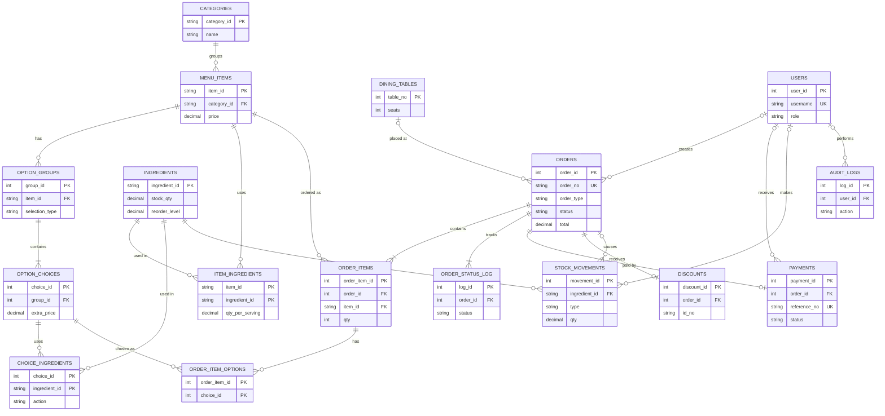
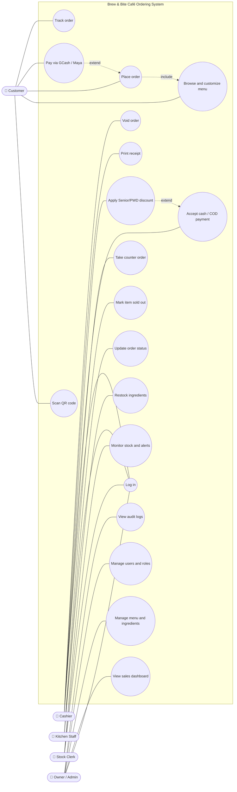
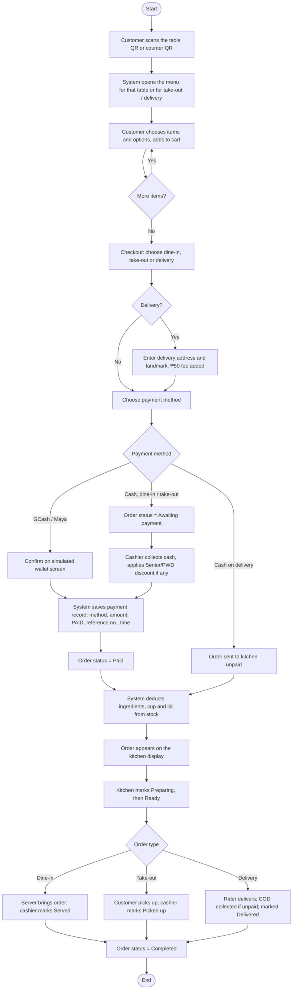
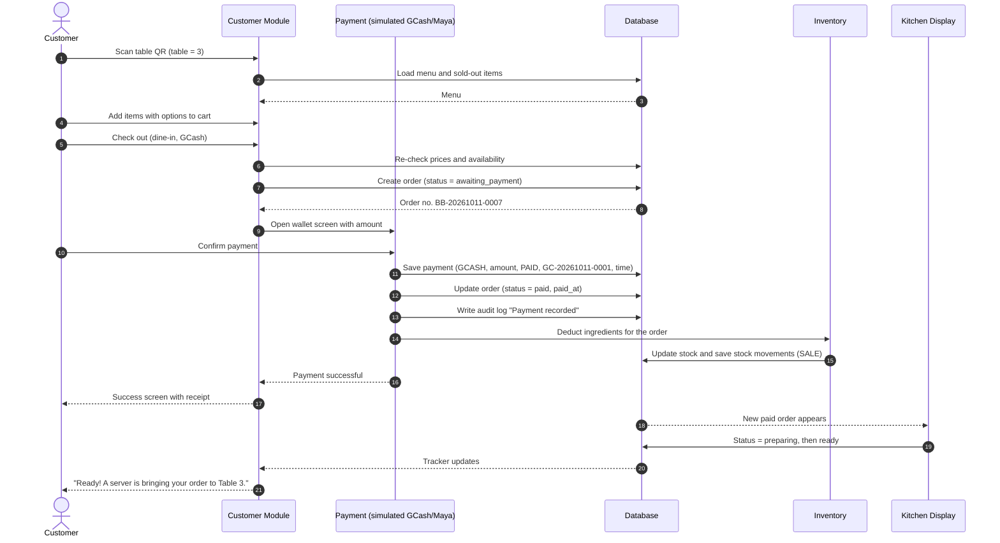

<!-- ===================== TITLE PAGE ===================== -->
<!-- Note: Hide the footer and page number on this front page. -->

# DOMINICAN COLLEGE OF TARLAC, INC.

## BREW & BITE CAFÉ: A QR-BASED ORDERING, PAYMENT AND INVENTORY MANAGEMENT SYSTEM

A Final Project Presented to  
the instructor of the College of Computer Studies,  
Dominican College of Tarlac, Inc.

In Partial Fulfillment of the Requirements  
for the subjects of

**IT52 – System Integration and Architecture**  
**IT54 – Advance Database System**  
**IT55 – Advance Web Development**

of Bachelor of Science in Information Technology

by:

[Last Name, First Name, Middle Initial]  
[Last Name, First Name, Middle Initial]  
[Last Name, First Name, Middle Initial]  
[Last Name, First Name, Middle Initial]

**Jan Nicole B. Apostol**  
IT 52 - Instructor

**Miguel S. Manugue**  
IT 54 & IT 55 - Instructor

2026

---

<!-- ===================== DOCUMENT BODY ===================== -->

## 1. Business/Project Overview

Brew & Bite Café is a small café on F. Tañedo St., San Nicolas, Tarlac City. It serves coffee, non-coffee drinks, milk tea, frappes, all-day rice meals, pastries and snacks. It is open Monday to Sunday from 7:00 AM to 10:00 PM. Customers dine in at five tables (two 2-seaters, two 4-seaters and one 6-seater), take their orders out, or have them delivered within Tarlac City for a flat ₱50 fee.

Like many small cafés, Brew & Bite takes orders verbally at a single counter. At peak hours this causes long queues, misheard orders and slow table turnover. Payments are recorded by hand. The kitchen works from paper slips, and nobody knows how much milk, coffee beans or cups are left until they run out.

The **Brew & Bite Café Ordering System** is a web-based system that connects every part of the café's daily operation:

- **Customers** scan the QR code on their table, which already identifies the table. They browse the menu, customize their drinks, and pay through a simulated GCash or Maya payment or in cash. They can then follow their order's progress on their own phone. A separate counter QR handles take-out and delivery orders.
- **Cashiers** take walk-in orders on a point-of-sale (POS) screen, collect cash and cash-on-delivery payments, and apply Senior Citizen and PWD discounts. They print receipts and void orders when needed.
- **Kitchen staff** see paid orders on a kitchen display. They move each order from *Preparing* to *Ready* and mark items as sold out.
- **Stock clerks** monitor ingredient levels. Ingredients are deducted automatically whenever an order is paid. The clerk records deliveries and physical counts.
- **The owner (admin)** watches daily sales on a dashboard, manages the menu, prices and each item's ingredients, manages staff accounts and roles, and reviews an audit log of every important action.

The system has eight web pages: a public homepage, a system navigator for demonstrations, the customer ordering module, a staff login, and the cashier, kitchen, inventory and admin modules. It is built with HTML, CSS and JavaScript as a fully navigable prototype. Records such as orders, payments, stock and the audit log are kept in the browser's local storage, which stands in for the MySQL database designed in Section 4. Payments are simulated: no real money moves and no outside payment service is contacted. Each payment still produces a proper payment record and reference number, for example `GC-20261011-0001`.

## 2. Business Objectives

1. **Shorten ordering time and queues.** Dine-in customers order and pay from their table through the table QR code, so they don't have to line up at the counter. The cashier is free to serve walk-in and take-out customers.
2. **Reduce order errors.** Customers choose their own items, sizes, temperature, sugar level, add-ons and notes. The kitchen receives exactly what was ordered, so no one has to retell it verbally.
3. **Speed up order preparation.** Paid orders appear on the kitchen display immediately, in the order they were received, with the table number or order type.
4. **Keep accurate payment records.** Every payment, whether GCash, Maya or cash, is saved with its method, amount, status, reference number and time, and is linked to its order.
5. **Apply discounts correctly.** The system computes the Senior Citizen and PWD discount the same way every time. It removes the 12% VAT from the eligible share, then takes 20% off it, and records the ID number used.
6. **Monitor stock automatically.** Each menu item lists the ingredients it uses per serving. Paying for an order deducts those ingredients, plus a cup and lid for drinks. Low-stock and out-of-stock ingredients are flagged, and items that cannot be made are shown as sold out.
7. **Protect customer privacy.** Customers order without giving their name or contact number. Only a delivery address is asked for, and only for delivery orders.
8. **Hold staff accountable.** Each staff member has their own login and role, and important actions are written to an audit log. These include logins, payments, voids, discounts, menu changes and stock changes.
9. **Give the owner a clear view of the business.** The admin dashboard shows today's sales, paid orders, average order value and discounts. Each figure is compared with the same time last week.

## 3. System Features

### 3.1 Public pages

| Feature | Description |
|---|---|
| **Homepage** (`home.html`) | A simple promotional page: the café's story, featured drinks and meals, location, opening hours and contact details. It explains that ordering is done by scanning the QR code on the table. |
| **System navigator** (`index.html`) | A demonstration page that opens every screen. Its floor plan shows the five tables, each with a QR standee in the middle; opening a table works the same as scanning its QR code. A motorcycle tile opens the counter QR for take-out and delivery. The page also shows live counts of today's orders, unpaid orders, orders in the kitchen and low-stock ingredients. |

### 3.2 Customer module (`customer.html`)

| Feature | Description |
|---|---|
| **QR ordering session** | The table QR (`customer.html?table=3`) starts a dine-in session for that table. The counter QR (`customer.html?type=takeout`) starts a take-out or delivery session. The customer never has to pick a table. |
| **Menu** | Items grouped by category, with search, *Best seller* and *New* labels, and sold-out items greyed out. |
| **Item customization** | Size (Medium 12 oz or Large 16 oz), temperature (hot or iced), sugar level, add-ons and a note for the kitchen. The price updates as options are chosen. |
| **Cart** | Change quantities or remove lines. If the owner changed a price or removed an item since it was added, the cart updates itself and tells the customer. |
| **Checkout** | Choose dine-in, take-out or delivery, and a payment method: GCash, Maya or cash. Delivery asks only for an address and an optional landmark, and adds the ₱50 delivery fee. No name or mobile number is collected. |
| **Simulated GCash / Maya payment** | A wallet screen that confirms the amount. On *Pay*, the system saves a payment record with method, amount, *Paid* status, a reference number such as `GC-20261011-0001` and the timestamp. The order becomes *Paid* and goes to the kitchen. |
| **Cash and cash on delivery** | Dine-in and take-out cash orders wait as *Awaiting payment* until the cashier collects the money. Delivery cash orders go to the kitchen at once and are paid to the rider. |
| **Success screen and receipt** | The order number, items, totals and payment reference. |
| **Order tracker** | A live progress bar: *Order received → Preparing → Ready / Out for delivery → Completed*. A "My orders" list keeps the orders placed on that phone. |

> **<<INCLUDE SCREENSHOTS>>**
> Figure 3.1 – Homepage · Figure 3.2 – System navigator floor plan · Figure 3.3 – Customer menu · Figure 3.4 – Item customization · Figure 3.5 – Cart · Figure 3.6 – Checkout (delivery) · Figure 3.7 – Simulated GCash payment · Figure 3.8 – Order success and receipt · Figure 3.9 – Order tracker

### 3.3 Staff login (`login.html`)

Staff sign in with a username and password. The system opens the screen that matches their role: Cashier → Point of Sale, Kitchen → Kitchen Display, Stock clerk → Stock, Owner/Admin → Dashboard. Pages outside a user's role are blocked. The Owner/Admin can open every module.

| Role | Can use |
|---|---|
| Owner / Admin | All modules, plus the dashboard, menu and prices, users and roles, and audit logs |
| Cashier | Point of Sale, Orders, Payment, Receipt |
| Kitchen | Kitchen Display, sold-out switches |
| Stock clerk | Stock (ingredients, low-stock alerts, restocking) |

### 3.4 Cashier module (`cashier.html`)

| Feature | Description |
|---|---|
| **Point of Sale** | Take walk-in orders by tapping menu items and choosing options. Set dine-in (with table number), take-out or delivery, then charge the order. |
| **Orders** | Every order of the day, with tabs for *Awaiting payment*, *In progress* and *Completed*, and search by order number. Action buttons depend on the order's stage: take payment, collect COD payment, mark served, picked up or delivered, view the receipt, or void. |
| **Payment** | Choose cash, GCash or Maya. Cash payments compute change from the amount tendered. The Senior Citizen / PWD discount records the ID type and number, the number of eligible persons and the number of diners, so the discount applies only to the eligible share. |
| **Receipt** | A printable receipt with the order number, items, discount, delivery fee, total, payment method, reference number and cashier name. |
| **Void** | Voiding a paid order asks for a reason, marks the payment *Voided* and returns the deducted ingredients to stock. |

> **<<INCLUDE SCREENSHOTS>>**
> Figure 3.10 – Staff login · Figure 3.11 – Point of Sale · Figure 3.12 – Orders list · Figure 3.13 – Payment with Senior/PWD discount · Figure 3.14 – Receipt

### 3.5 Kitchen module (`kitchen.html`)

| Feature | Description |
|---|---|
| **Kitchen display** | Order tickets in columns for *New*, *Preparing* and *Ready*. Each ticket shows the order number, table or order type, QR or counter source, items with their options and notes, and how long ago the order came in. |
| **Order progress** | Staff move a ticket from *New* to *Preparing* to *Ready*. The customer's tracker updates at the same time. |
| **Sold-out switches** | The kitchen can mark an item sold out, or available again. The change shows immediately on the customer menu and the POS. |
| **Dark display** | The display is dark by default for easy reading in the kitchen; a light mode is available. |

> **<<INCLUDE SCREENSHOTS>>**
> Figure 3.15 – Kitchen display · Figure 3.16 – Sold-out switches

### 3.6 Inventory module (`inventory.html`)

| Feature | Description |
|---|---|
| **Stock list** | Every ingredient with its stock on hand, reorder level, stock value and status (*OK*, *Low* or *Out*). Filter by category and search by name. |
| **Low-stock alerts** | Summary cards for low and out-of-stock ingredients. A banner lists the menu items that cannot be made because an ingredient has run out. |
| **Automatic deduction** | When an order is paid, the system deducts each item's ingredients, plus a 12 oz or 16 oz cup and a lid for drinks and any add-on ingredients. A voided or cancelled order puts them back. |
| **Restock** | Record a delivery (*Add a delivery*) or a physical count (*Set counted amount*), with an optional note. A preview shows the stock before and after. |
| **Add or edit ingredient** | Name, category, unit (g, ml or pc), reorder level, usual restock quantity, cost per unit and opening stock. |
| **History** | Every stock movement for an ingredient: sale, return, purchase or adjustment, with quantity, before and after amounts, reference and the staff member who made it. |

> **<<INCLUDE SCREENSHOTS>>**
> Figure 3.17 – Stock list with low-stock alerts · Figure 3.18 – Restock form · Figure 3.19 – Stock history

### 3.7 Admin module (`admin.html`)

| Feature | Description |
|---|---|
| **Dashboard** | Today's sales, paid orders, average order and Senior/PWD discounts, each compared with the same time last week. Also sales for the last 14 days, orders by hour, payment methods, best sellers, recent activity and things that need attention (unpaid orders, low stock). |
| **Menu & prices** | Add, edit or remove menu items and categories. Set price, description, labels, option set (sizes, temperature, sugar level, add-ons) and the **ingredients used per serving**, which are deducted from stock when the item sells. |
| **Users & roles** | Add and edit staff accounts, assign roles, change passwords and deactivate accounts. The list shows each user's status and last login, and a table shows what each role can do. |
| **Audit logs** | Every logged action with date and time, user, role, module, action and details. Filter by period, module and user, search, and export to CSV. |
| **Reset demo data** | Clears all saved records and restores the sample data, for demonstrations. |

> **<<INCLUDE SCREENSHOTS>>**
> Figure 3.20 – Admin dashboard · Figure 3.21 – Menu & prices · Figure 3.22 – Item editor with ingredients · Figure 3.23 – Users & roles · Figure 3.24 – Audit logs

### 3.8 Interface

All modules share one design: a warm "Roastery" colour palette, a light/dark mode switch, and layouts that work on phones (customer module), tablets (kitchen) and desktops (cashier, inventory, admin).

## 4. Data Dictionary

The tables below describe the database designed for the system (MySQL). The prototype keeps the same records in the browser's local storage under keys that start with `bb_`, such as `bb_orders`, `bb_payments` and `bb_movements`.

**Legend:** PK = primary key, FK = foreign key, UQ = unique, NN = not null.

### 4.1 `users` – staff accounts

| Field | Data Type | Key / Constraint | Description |
|---|---|---|---|
| user_id | INT AUTO_INCREMENT | PK | Unique ID of the staff member |
| full_name | VARCHAR(100) | NN | Staff member's full name |
| username | VARCHAR(50) | UQ, NN | Login name |
| password_hash | VARCHAR(255) | NN | Hashed password |
| role | ENUM('admin','cashier','kitchen','inventory') | NN | Decides which modules the user can open |
| is_active | TINYINT(1) | NN, default 1 | 0 = deactivated; cannot log in |
| created_at | DATETIME | NN | When the account was created |

### 4.2 `categories` – menu categories

| Field | Data Type | Key / Constraint | Description |
|---|---|---|---|
| category_id | VARCHAR(20) | PK | e.g. `coffee`, `milktea`, `meals` |
| name | VARCHAR(50) | UQ, NN | Name shown on the menu |
| is_drink | TINYINT(1) | NN, default 0 | 1 = items need a cup and lid |
| sort_order | INT | NN | Order on the menu |

### 4.3 `menu_items` – products sold

| Field | Data Type | Key / Constraint | Description |
|---|---|---|---|
| item_id | VARCHAR(30) | PK | e.g. `latte` |
| category_id | VARCHAR(20) | FK → categories, NN | Category of the item |
| name | VARCHAR(100) | UQ, NN | Item name |
| description | VARCHAR(255) | | Short description |
| price | DECIMAL(8,2) | NN, > 0 | Base price (Medium / single serving) |
| is_best_seller | TINYINT(1) | default 0 | Shows the *Best seller* label |
| is_new | TINYINT(1) | default 0 | Shows the *New* label |
| sold_out_override | TINYINT(1) | NULL | Set by the kitchen; NULL = follow stock levels |
| is_active | TINYINT(1) | NN, default 1 | 0 = removed from the menu |

### 4.4 `option_groups` – customization groups of an item

| Field | Data Type | Key / Constraint | Description |
|---|---|---|---|
| group_id | INT AUTO_INCREMENT | PK | Unique ID |
| item_id | VARCHAR(30) | FK → menu_items, NN | Item the group belongs to |
| name | VARCHAR(50) | NN | Size, Temperature, Sugar level or Add-ons |
| selection_type | ENUM('single','multi') | NN | Choose one, or any number |
| is_required | TINYINT(1) | NN | Customer must choose one |

### 4.5 `option_choices` – choices inside a group

| Field | Data Type | Key / Constraint | Description |
|---|---|---|---|
| choice_id | INT AUTO_INCREMENT | PK | Unique ID |
| group_id | INT | FK → option_groups, NN | Group of the choice |
| name | VARCHAR(50) | NN | e.g. Large (16 oz), Oat milk, 50% |
| extra_price | DECIMAL(8,2) | NN, default 0 | Added to the item price |
| is_default | TINYINT(1) | default 0 | Pre-selected choice |

### 4.6 `ingredients` – stock items

| Field | Data Type | Key / Constraint | Description |
|---|---|---|---|
| ingredient_id | VARCHAR(30) | PK | e.g. `beans`, `milk`, `cup12` |
| name | VARCHAR(100) | UQ, NN | Ingredient name |
| category | VARCHAR(50) | NN | e.g. Coffee & tea, Dairy, Packaging |
| unit | ENUM('g','ml','pc') | NN | Unit of measure |
| stock_qty | DECIMAL(10,2) | NN, ≥ 0 | Quantity on hand |
| reorder_level | DECIMAL(10,2) | NN | At or below this, the ingredient is *Low* |
| restock_qty | DECIMAL(10,2) | | Usual quantity ordered |
| unit_cost | DECIMAL(10,3) | NN | Cost per unit (₱), used for stock value |

### 4.7 `item_ingredients` – ingredients used per serving

| Field | Data Type | Key / Constraint | Description |
|---|---|---|---|
| item_id | VARCHAR(30) | PK, FK → menu_items | Menu item |
| ingredient_id | VARCHAR(30) | PK, FK → ingredients | Ingredient used |
| qty_per_serving | DECIMAL(10,2) | NN, > 0 | Amount deducted per serving (same at every size) |

### 4.8 `choice_ingredients` – ingredients used by an option

| Field | Data Type | Key / Constraint | Description |
|---|---|---|---|
| choice_id | INT | PK, FK → option_choices | Option, e.g. Extra espresso shot |
| ingredient_id | VARCHAR(30) | PK, FK → ingredients | Ingredient used or swapped in |
| qty | DECIMAL(10,2) | | Amount added (for `add`) |
| action | ENUM('add','replace') | NN | `add` = extra ingredient; `replace` = swaps one ingredient for another (e.g. oat milk for fresh milk) |
| replaces_id | VARCHAR(30) | FK → ingredients, NULL | Ingredient being replaced |

### 4.9 `dining_tables` – tables with QR codes

| Field | Data Type | Key / Constraint | Description |
|---|---|---|---|
| table_no | INT | PK | Table number (1–5) |
| seats | INT | NN | 2, 4 or 6 |
| qr_url | VARCHAR(255) | UQ, NN | Link printed on the table's QR code |
| is_active | TINYINT(1) | NN, default 1 | Table in use |

### 4.10 `orders` – customer and counter orders

| Field | Data Type | Key / Constraint | Description |
|---|---|---|---|
| order_id | INT AUTO_INCREMENT | PK | Unique ID |
| order_no | VARCHAR(20) | UQ, NN | Daily number, e.g. `BB-20261011-0007` |
| source | ENUM('qr','pos') | NN | Customer QR or cashier POS |
| order_type | ENUM('dine-in','take-out','delivery') | NN | How the order is served |
| table_no | INT | FK → dining_tables, NULL | Only for dine-in |
| delivery_address | VARCHAR(255) | NULL | Only for delivery |
| delivery_landmark | VARCHAR(150) | NULL | Optional, for delivery |
| subtotal | DECIMAL(10,2) | NN | Sum of item lines |
| discount_amount | DECIMAL(10,2) | NN, default 0 | Senior/PWD discount |
| delivery_fee | DECIMAL(8,2) | NN, default 0 | ₱50 for delivery |
| total | DECIMAL(10,2) | NN | subtotal − discount + delivery fee |
| payment_method | ENUM('GCASH','MAYA','CASH') | NULL | Chosen method |
| status | ENUM('awaiting_payment','paid','preparing','ready','completed','cancelled','voided') | NN | Current stage |
| cancel_reason | VARCHAR(255) | NULL | Reason for cancel or void |
| stock_deducted | TINYINT(1) | NN, default 0 | 1 = ingredients already deducted |
| created_by | INT | FK → users, NULL | Cashier for POS orders; NULL for QR orders |
| created_at | DATETIME | NN | When the order was placed |
| paid_at | DATETIME | NULL | When it was paid |

### 4.11 `order_items` – lines of an order

| Field | Data Type | Key / Constraint | Description |
|---|---|---|---|
| order_item_id | INT AUTO_INCREMENT | PK | Unique ID |
| order_id | INT | FK → orders, NN | Parent order |
| item_id | VARCHAR(30) | FK → menu_items, NN | Item ordered |
| item_name | VARCHAR(100) | NN | Name at the time of ordering |
| unit_price | DECIMAL(8,2) | NN | Base price plus options, at the time of ordering |
| qty | INT | NN, > 0 | Quantity |
| notes | VARCHAR(150) | NULL | Note for the kitchen |

### 4.12 `order_item_options` – options chosen for a line

| Field | Data Type | Key / Constraint | Description |
|---|---|---|---|
| order_item_id | INT | PK, FK → order_items | Order line |
| choice_id | INT | PK, FK → option_choices | Chosen option |
| choice_name | VARCHAR(50) | NN | Name at the time of ordering |
| extra_price | DECIMAL(8,2) | NN | Price at the time of ordering |

### 4.13 `order_status_log` – order progress history

| Field | Data Type | Key / Constraint | Description |
|---|---|---|---|
| log_id | INT AUTO_INCREMENT | PK | Unique ID |
| order_id | INT | FK → orders, NN | Order |
| status | VARCHAR(20) | NN | New status |
| changed_at | DATETIME | NN | When it changed |
| changed_by | INT | FK → users, NULL | Staff member; NULL when the customer's payment changed it |

### 4.14 `payments` – payment records

| Field | Data Type | Key / Constraint | Description |
|---|---|---|---|
| payment_id | INT AUTO_INCREMENT | PK | Unique ID |
| order_id | INT | FK → orders, UQ, NN | Order paid |
| method | ENUM('GCASH','MAYA','CASH') | NN | Payment method |
| amount | DECIMAL(10,2) | NN | Amount paid |
| reference_no | VARCHAR(20) | UQ, NN | `GC-`, `MY-` or `CS-` + date + sequence, e.g. `GC-20261011-0001` |
| status | ENUM('PAID','VOIDED') | NN | Payment status |
| amount_tendered | DECIMAL(10,2) | NULL | Cash given (cash only) |
| change_due | DECIMAL(10,2) | NULL | Change returned (cash only) |
| received_by | INT | FK → users, NULL | Cashier; NULL for customer e-wallet payments |
| paid_at | DATETIME | NN | Payment time |
| voided_at | DATETIME | NULL | Void time |
| void_reason | VARCHAR(255) | NULL | Reason for the void |

### 4.15 `discounts` – Senior Citizen / PWD discounts

| Field | Data Type | Key / Constraint | Description |
|---|---|---|---|
| discount_id | INT AUTO_INCREMENT | PK | Unique ID |
| order_id | INT | FK → orders, UQ, NN | Discounted order |
| discount_type | ENUM('Senior','PWD') | NN | Type of card presented |
| id_no | VARCHAR(30) | NN | Senior Citizen / PWD ID number |
| holder_name | VARCHAR(100) | NULL | Name on the ID card |
| eligible_count | INT | NN, ≥ 1 | Number of seniors/PWDs in the group |
| diner_count | INT | NN, ≥ eligible_count | Number of people sharing the order |
| amount | DECIMAL(10,2) | NN | Computed discount |

### 4.16 `stock_movements` – every change to stock

| Field | Data Type | Key / Constraint | Description |
|---|---|---|---|
| movement_id | INT AUTO_INCREMENT | PK | Unique ID |
| ingredient_id | VARCHAR(30) | FK → ingredients, NN | Ingredient |
| type | ENUM('SALE','RETURN','PURCHASE','ADJUST') | NN | Sold, returned from a void, delivery received, or count/opening stock |
| qty | DECIMAL(10,2) | NN | Signed quantity: negative uses stock, positive adds it |
| qty_before | DECIMAL(10,2) | NN | Stock before the change |
| qty_after | DECIMAL(10,2) | NN | Stock after the change |
| cost | DECIMAL(10,2) | NN | qty × unit cost |
| order_id | INT | FK → orders, NULL | Related order (SALE, RETURN) |
| note | VARCHAR(255) | NULL | e.g. "Delivery received", "Physical count" |
| user_id | INT | FK → users, NULL | Staff member; NULL when automatic |
| moved_at | DATETIME | NN | When it happened |

### 4.17 `audit_logs` – actions done in the system

| Field | Data Type | Key / Constraint | Description |
|---|---|---|---|
| log_id | INT AUTO_INCREMENT | PK | Unique ID |
| user_id | INT | FK → users, NULL | Staff member; NULL for customer actions |
| role | VARCHAR(20) | NN | Role at the time, or `customer` |
| action | VARCHAR(100) | NN | e.g. Logged in, Payment recorded, Voided order |
| detail | VARCHAR(255) | | e.g. `BB-20261011-0007 · GCASH · ₱310.00 · GC-20261011-0003` |
| logged_at | DATETIME | NN | When it happened |

## 5. Requirements Modeling

### 5.1 Entity Relationship Diagram

*Figure 5.1 – Entity Relationship Diagram of the Brew & Bite Café Ordering System*

### 5.2 Functional Decomposition Diagram

```mermaid
flowchart TD
    S["Brew & Bite Café<br/>Ordering System"]
    S --> C["1.0 Customer Ordering"]
    S --> K["2.0 Cashier / POS"]
    S --> KD["3.0 Kitchen"]
    S --> I["4.0 Inventory"]
    S --> A["5.0 Administration"]

    C --> C1["1.1 Scan table or counter QR"]
    C --> C2["1.2 Browse and customize menu items"]
    C --> C3["1.3 Manage cart"]
    C --> C4["1.4 Check out"]
    C --> C5["1.5 Pay via GCash / Maya (simulated) or cash"]
    C --> C6["1.6 View receipt and track order"]

    K --> K1["2.1 Log in"]
    K --> K2["2.2 Take counter orders"]
    K --> K3["2.3 Accept payments and COD"]
    K --> K4["2.4 Apply Senior/PWD discount"]
    K --> K5["2.5 Print receipt"]
    K --> K6["2.6 Complete or void orders"]

    KD --> KD1["3.1 View incoming orders"]
    KD --> KD2["3.2 Update order status"]
    KD --> KD3["3.3 Mark items sold out"]

    I --> I1["4.1 Monitor stock levels"]
    I --> I2["4.2 Low-stock alerts"]
    I --> I3["4.3 Auto-deduct ingredients"]
    I --> I4["4.4 Restock / record counts"]
    I --> I5["4.5 Manage ingredients"]
    I --> I6["4.6 View stock history"]

    A --> A1["5.1 Sales dashboard"]
    A --> A2["5.2 Manage menu, prices and ingredients"]
    A --> A3["5.3 Manage users and roles"]
    A --> A4["5.4 View and export audit logs"]
```

*Figure 5.2 – Functional Decomposition Diagram*

### 5.3 Use Case Diagram

*Figure 5.3 – Use Case Diagram. The Owner/Admin can also perform every Cashier, Kitchen and Stock Clerk use case.*

### 5.4 Activity Diagram

*Figure 5.4 – Activity Diagram of placing and fulfilling an order*

### 5.5 Sequence Diagram

*Figure 5.5 – Sequence Diagram of a dine-in order paid through GCash*

## 6. Problems and Solutions

| # | Problem | Solution |
|---|---|---|
| 1 | **Long queues at the counter.** All orders pass through one cashier, so customers wait in line at peak hours. | Dine-in customers order and pay from their table through the QR code. The cashier only handles walk-in orders and cash payments. |
| 2 | **Wrong or missing orders.** Orders taken verbally are misheard, and paper slips get lost or are hard to read. | Customers choose their own options, and orders reach the kitchen display exactly as entered, with notes. |
| 3 | **Customers don't know their order's status.** They ask the staff repeatedly whether their order is ready. | The order tracker shows the order's progress on the customer's phone in real time. |
| 4 | **No proof of e-wallet payments.** Staff have to check screenshots of GCash or Maya transfers by hand. | Every payment is saved with method, amount, status, reference number and time. For this project the e-wallet step is simulated; a real payment gateway can be connected later. |
| 5 | **Inconsistent Senior/PWD discounts.** Cashiers compute the discount by hand, sometimes on the whole bill instead of the eligible share. | The system removes the VAT and applies 20% only to the eligible share, based on the number of eligible persons and diners. The ID number is recorded and logged. |
| 6 | **Ingredients run out without warning.** Stock is counted only when something is already gone, and items are sold that can no longer be made. | Ingredients are deducted automatically per serving whenever an order is paid. Low-stock alerts appear, and items whose ingredients have run out show as sold out. |
| 7 | **Stock discrepancies cannot be traced.** Nobody knows where missing stock went. | Every stock change is saved as a movement with its type, quantity, before and after amounts, order reference and staff member. |
| 8 | **No accountability for voids and changes.** Voided sales and price changes are not recorded. | Staff log in with personal accounts and roles. Voids need a reason, and every important action goes to the audit log, which the owner can filter and export. |
| 9 | **Customers' carts could carry outdated prices.** A cart saved before the owner changed a price or removed an item could be checked out with the old details. | The cart and the POS ticket re-check every line against the current menu. Prices are updated, removed items are dropped, and the customer is told what changed before paying. |
| 10 | **Collecting personal data raises privacy concerns.** Asking every customer for a name and mobile number is unnecessary and adds Data Privacy Act obligations. | The system does not ask for a name or contact number. Orders are identified by order number, and only delivery orders ask for an address. |
| 11 | **No live database or payment gateway during development.** The prototype had to run as static pages. | Records are kept in the browser's local storage using the same structure as the database design. Payments are simulated but produce the same records a real payment would. |

## 7. Conclusion and Recommendations

### 7.1 Conclusion

The Brew & Bite Café Ordering System shows how a small café can move from verbal orders and paper slips to a single connected system. Customers order and pay from their table through a QR code. Cashiers handle walk-in orders, cash payments and discounts in one place. The kitchen receives clear, complete orders on a display, and every paid order automatically deducts the ingredients it uses from stock. The owner sees daily sales and stock levels and can trace every important action through the audit log.

The project meets its objectives. It shortens ordering time, reduces order errors, records every payment with a reference number, applies Senior/PWD discounts consistently, monitors stock automatically and protects customer privacy by not collecting personal details. The working prototype demonstrates all of these processes from start to finish, and its data dictionary and diagrams provide the design for building the full database-backed system.

### 7.2 Recommendations

1. **Connect a real database.** Move the records from browser storage to the MySQL database described in Section 4, using a server-side API (for example PHP or Laravel on the Laragon server), so that all devices share the same data.
2. **Integrate real e-wallet payments.** Replace the simulated GCash/Maya screen with a licensed payment gateway such as PayMongo, Xendit or Maya Business, and confirm payments through the gateway's webhook.
3. **Secure the system.** Store passwords as hashes, use HTTPS, add session timeouts, and sign the table QR codes so they cannot be guessed or tampered with.
4. **Add real-time updates.** Use WebSockets or server-sent events so the kitchen display and order tracker update instantly across devices.
5. **Add BIR-compliant receipts and reports.** Issue official receipts with the café's TIN and serial numbers, and produce end-of-day, X- and Z-readings if the system will replace a registered cash register.
6. **Include suppliers and purchasing later.** Once stock monitoring is working well, add supplier records and purchase orders so restocking can be planned instead of only recorded.
7. **Train staff and gather feedback.** Hold a short training for each role, run the system alongside the current process for a trial period, and improve it based on staff and customer feedback.

---

<!-- ===================== FORMATTING INSTRUCTIONS ===================== -->

## FOLLOW THIS FORMAT (REMOVE THIS PART ONCE YOU HAVE READ IT)

| Setting | Requirement |
|---|---|
| **Font** | Times New Roman |
| **Font Size** | 12 pts (Title); 11 pts (Content) |
| **Line Spacing** | 1.5; remove space before and after paragraph |
| **Margins** | 1 inch on all sides |
| **Alignment** | Justified |
| **Paper Size** | 8.5 x 11 inches |
| **Soft Copy** | Submit to Google Drive |
| **Hard Copy** | Submit documentation on or before **October 16, 2026** |

### Footer Layout

| Left side | Right side |
|---|---|
| Case study title | Page # |

> **Note:** For the front page, hide the footer and page number.

